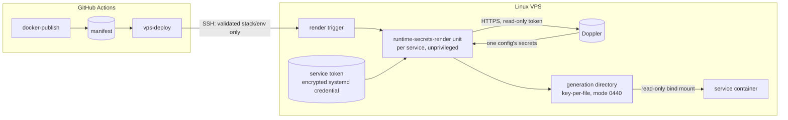

# Doppler runtime secrets architecture

Status: **Architecture plus implemented host primitive (DEVOPS-006/007).** The reusable helper, schemas, systemd templates and Compose contract are implemented. Doppler tenant resources, application adoption and deployment-workflow orchestration remain separate work ([implementation dependencies](#implementation-dependencies)).

This document set defines how applications deployed by the toolkit obtain long-lived runtime secrets from Doppler on the **Developer (free)** plan without placing them in GitHub Actions, container images, release manifests, source control, or persistent VPS environment variables. It replaces the earlier, unreleased Infisical design ([provider change](#provider-change-from-infisical)).

| Document | Scope |
| --- | --- |
| [Architecture](architecture.md) (this file) | Verified Doppler capabilities, hierarchy, isolation analysis, delivery model, GitHub Actions boundary |
| [Secret inventory](secret-inventory.md) | Verified and planned secrets in the reference templates, consumers, proposed configs, rotation impact |
| [Access policy](access-policy.md) | Service-token model, allocation, human access, Free-plan limits and compensating controls |
| [VPS bootstrap and delivery](vps-bootstrap.md) | Implemented CLI contract, token bootstrap, tmpfs layout, atomic lifecycle and failure behavior |
| [Rotation and revocation](rotation-and-revocation.md) | Routine rotation and emergency runbooks |
| [Audit and threat model](audit-and-threat-model.md) | Audit sources, access reviews, threats, controls, residual risk |

## Conventions

- **Verified** means checked against official Doppler documentation or pricing on **2026-11-21** ([sources](#sources-and-verification)). **Proposed** means a design decision of this ticket. **Unverified** means the behavior must be proven by an [acceptance test](access-policy.md#acceptance-tests) before production use.
- All names are placeholders: `example-backend`, `example-frontend`, `vps01`. No real identifiers or values appear anywhere.
- *Application* means one independently deployed Compose stack, normally one repository. It corresponds to the toolkit `stack-name` without its environment suffix.
- *Service* means a Compose service name (for example `webapi`, `database-migrator`). Runtime secrets belong to running services, and some services (for example a telemetry collector) are not toolkit-published image components.
- Host-side names (`runtime-secrets-*` units, `/run/runtime-secrets`) stay application agnostic. The retrieval adapter is deliberately Doppler-specific; this ticket does not create a speculative multi-provider framework.

## Goals and non-goals

Goals:

1. Application, environment, and service isolation for every runtime credential, enforced by Doppler token scope rather than convention alone.
2. Read-only runtime access. No runtime credential can create, change, or delete secrets.
3. Production application secrets never transit GitHub Actions.
4. Secret values never enter images, build arguments, OCI labels, manifests, logs, or source control.
5. One Linux VPS can host several applications and environments without sharing tokens or secret files.
6. A design the toolkit can implement once and reuse for future applications without knowing their configuration schema.
7. Achievable on the Doppler Developer plan, with every paid-only gap named and compensated.

Non-goals for DEVOPS-007: creating Doppler resources, migrating real credentials, changing deployment workflows or application templates, adding Doppler SDKs to applications, and a generic multi-provider framework.

## Verified Doppler capabilities (Developer plan)

Checked on 2026-11-21. Limits come from the Platform Limits page (last updated 2026-10-06) and plan features from the pricing page.

### Limits that constrain the design

| Limit | Developer | Team | Design impact |
| --- | --- | --- | --- |
| Users | Free for 3, then paid per user, maximum 25 | 500 | Production-capable membership is limited to secrets administrators |
| Projects | **10** | 250 | One project per application leaves room for 10 applications. Rules out project-per-service at scale |
| Environments per project | **4** | 15 | `dev`, `stg`, `prd` fit, with one spare |
| Configs per environment | **10** | 100 | Root plus at most 9 service configs per environment (whether the root counts is **unverified**; assume it does) |
| Service tokens | **50** | 500 | Budget below. Whether the limit is per workplace or per config is **unverified**; assume per workplace |
| Service accounts | None | 250 | Not available. Service tokens are the only machine credential |
| Activity log retention | **3 days** | 90 days | Requires frequent review and external evidence ([audit](audit-and-threat-model.md)) |
| Trusted IPs per config | None | 20 | A stolen token works from anywhere until revoked or expired |
| Webhooks | 5 | 50 | Used for durable change notifications |
| Secret value / config payload / secrets per config | 50 KiB / 500 KiB / 1,200 | Same | Far above the reference needs |
| API secrets-read rate | 120 per minute per token | 240 | One read per render; not a constraint |

### Features and plan availability

| Capability | Developer | Paid | Used by this design |
| --- | --- | --- | --- |
| Projects, environments, root and branch configs | Yes | Yes | Hierarchy |
| Service tokens: one config, read-only by default, optional write, optional expiry, shown once, immediate revocation | Yes | Yes | Only runtime credential |
| CLI and REST secret download | Yes | Yes | Host retrieval |
| Secret versioning and config-log rollback | Yes (retention relative to the 3-day log window is **unverified**) | Yes | Recovery from bad writes |
| Per-secret access logs (actor, access method, first and last read) | Yes; Free retention **unverified** | Yes | Detection |
| Secret referencing within one config | Yes | Yes | Not used for runtime secrets |
| Secret referencing across configs or projects | **No** | Yes | Not used |
| Config inheritance (a config inheriting other configs, across projects) | **No** | Team+ | Not used. Shared provider keys are duplicated instead |
| Role-based access, environment-scoped roles | **No** | Team+ | Unavailable. Compensated by membership policy |
| Custom roles, user groups | **No** | Team add-on / Enterprise | Unavailable |
| Trusted IPs | **No** | Team+ | Unavailable |
| SAML SSO | **No** | Team+ | Unavailable |
| SCIM, log forwarding, change-request policies, custom log retention | **No** | Enterprise (log forwarding conflicts: see [sources](#sources-and-verification)) | Unavailable |
| Service accounts and identity-based (OIDC) authentication | **No** | Team+ | Unavailable |

This design does **not** claim IP allowlisting, granular human RBAC, environment-scoped human access, or long-term audit retention on the Developer plan.

## Recommended hierarchy

### Model

```text
Doppler workplace: <organization>             Developer plan; Classic secret naming (default)
├── Project: example-backend                  one per application
│   ├── Environment dev  (slug dev)
│   │   ├── dev                               root config: holds NO runtime secrets
│   │   └── dev_webapi, dev_consumer, ...     only when a shared dev server exists
│   ├── Environment stg  (slug stg)
│   │   ├── stg                               root config: empty, locked
│   │   ├── stg_webapi
│   │   ├── stg_consumer
│   │   ├── stg_jobs
│   │   ├── stg_database-migrator
│   │   └── stg_otel-collector                planned
│   └── Environment prd  (slug prd)
│       ├── prd                               root config: empty, locked
│       ├── prd_webapi
│       ├── prd_consumer
│       ├── prd_jobs
│       ├── prd_database-migrator
│       └── prd_otel-collector                planned
└── Project: example-frontend                 created only when a server-side secret exists
    └── prd_user-portal, prd_admin-portal     reserved; same pattern
```

Rules:

1. **One Doppler project per application.** The project name equals the application name.
2. **Environments** use Doppler's default slugs `dev`, `stg`, `prd`. They map to the toolkit's deployment environments (for example `staging` → `stg`, `production` → `prd`). The mapping is recorded once per application in its host configuration, not hardcoded in the toolkit.
3. **One branch config per Compose service** that needs runtime secrets, named `<env-slug>_<service>`. Branch config names are prefixed with the environment slug (Verified). Whether a hyphen is accepted in the service segment is **unverified**. If it is rejected, provisioning uses the service name with `-` replaced by `_`, and records the mapping.
4. **Root configs hold no runtime secrets.** Every branch config inherits its root, so anything placed in a root reaches every service in that environment ([isolation analysis](#isolation-analysis)). Roots are locked after creation so they cannot be renamed or deleted, and are reviewed to stay empty.
5. **Every environment has the same configs and key names, with independent values.** A value is never copied from `prd` to a lower environment, and development values must not be valid against production providers.
6. **Non-secret configuration stays in application-owned `appsettings` or Compose files.** Doppler holds secrets, plus non-secret values that are only meaningful together with a secret (for example a username paired with its password).
7. **Secret references (`${...}`) are not used** in runtime configs. Cross-config references are paid-only anyway, and references make access harder to reason about.
8. **Personal configs** (per-user `dev` branches, on by default) are disabled in application projects, or restricted to `dev`, so that no personal branch exists beside production configs.

### Secret naming

The workplace keeps Doppler's default **Classic** naming: secret names may contain only uppercase letters, digits, and underscores, and may not start with a digit (Verified). Mixed-case names such as `ConnectionStrings__PostgresWrite` are rejected under Classic.

The toolkit convention is therefore an upper-case name with `__` as the hierarchy separator, for example `CONNECTIONSTRINGS__POSTGRESWRITE`. A future .NET adoption ticket can bind that file through `AddKeyPerFile`; DEVOPS-007 does not modify application code. The **Permissive** naming mode is not used: it is a workplace-wide switch, and keeping Classic makes file-name validation simple and strict.

### Isolation analysis

The question is whether branch configs isolate services well enough, given that they inherit from their root.

| Property | How it is achieved | Strength |
| --- | --- | --- |
| Application isolation | Separate projects; a service token is scoped to one config in one project | Doppler-enforced |
| Environment isolation for machines | A service token is scoped to one config, and each config belongs to one environment. A `stg_*` token cannot read `prd_*` | Doppler-enforced (negative acceptance test required) |
| Service isolation for machines | One token per service config. A branch token cannot read sibling branches | Doppler-enforced (negative acceptance test required) |
| Root-to-branch leakage | Every branch inherits its root, and updates propagate automatically (Verified) | **Convention.** Kept safe by an empty root, a locked root, an application-owned key allowlist on the host, and review |
| Removal of an inherited secret in a branch | Only overriding is documented | Not relied upon |
| Environment isolation for people | Not available on Developer (role-based access is Team+). Every member should be assumed to have full access to every environment | **Not enforced.** Compensated by [membership policy](access-policy.md#human-access) |

**Conclusion:** branch configs give adequate *machine* isolation on the Developer plan, **provided the root configs stay empty**. The one weakness, silent propagation of a value added to a root, is a configuration error, not an access-control bypass. It is detected on the host before delivery because the helper delivers only keys in the application-owned allowlist, and fails on any extra key ([delivery](vps-bootstrap.md#generation-writer-requirements)). The monthly review also checks that roots are empty.

Branch configs cannot provide *human* isolation on the Developer plan. That requires either a paid plan or the separate-workplace alternative below.

### Alternatives evaluated

| Option | Description | Machine isolation | Human isolation on Free | Project cost on Free (10 max) | Assessment |
| --- | --- | --- | --- | --- | --- |
| **A. Project per application, branch config per service, empty roots** | Recommended model above | Token per config | None | 1 per application | **Selected.** Fits the limits and gives per-service tokens. Inheritance risk controlled as described |
| B. Project per application and environment | `example-backend-prd` with branch configs per service | Same as A | None. Members still see every project | 3 per application (3 applications max) | Rejected. No security gain on Free, and it triples project use |
| C. Project per application and service | `example-backend-webapi` with `dev`/`stg`/`prd` roots and no branches | Same as A, without any inheritance | None | 4–5 per backend (2 applications max) | Fallback, only if inheritance must be removed entirely. It also disables native cross-environment comparison of one service's keys |
| D. Separate workplace for production | Workplace `<org>-prod` (`stg`, `prd`) holding only secrets administrators; workplace `<org>-dev` for developers | Same as A | **Yes**, by workplace membership | Each workplace has its own limits | Recommended **only if** developers need Doppler access before a paid plan. Each workplace is a separately administered account; confirm with Doppler that this use of free workplaces is acceptable before relying on it |
| E. Team plan | Option A plus environment-scoped roles, Trusted IPs, 90-day logs, service accounts | Same as A, plus IP restriction | Yes | 250 projects | The upgrade path. No change to the hierarchy or host delivery is needed |

### Shared provider credentials

Config inheritance and cross-config references are paid features, so a provider key needed by several services (for example a KYC key used by `webapi` and `jobs`) is **duplicated** into each consuming service config. It is never placed in the root config, which would expose it to every service.

When several services need the same backing system, prefer the strongest option the provider supports:

1. **Distinct credentials with distinct privileges** (best). Example: PostgreSQL login roles per service, where only `database-migrator` owns the schema.
2. **Distinct credentials with equal privileges.** Example: one Cloudflare R2 token or one RabbitMQ user per service. This gives independent rotation, revocation, and attribution.
3. **One provider-issued key duplicated** into each confirmed consumer's config. The [inventory](secret-inventory.md) records every duplicate, and the [rotation runbooks](rotation-and-revocation.md#duplicated-values) update all copies.

### Capacity on the Developer plan

| Resource | Backend reference (stg + prd, one host) | Limit | Headroom |
| --- | --- | --- | --- |
| Projects | 1 | 10 | 9 more applications |
| Configs in `prd` | 1 root + 5 services (with planned collector) | 10 | 4 more services |
| Service tokens | 10 (5 services × 2 environments) | 50 | Rotation briefly needs a second token per config (20 at peak). About 2 backend-sized applications per host fit with rotation overlap |

When the token budget is reached, upgrade to Team. Do not share tokens between services to save capacity, except under the recorded [shared-token alternative](access-policy.md#shared-token-alternative).

### Scaling to other topologies

- An application with fewer services has fewer configs and tokens. An application with no runtime secrets (the current frontend) has no project until a secret exists.
- An additional service adds one branch config per environment and one token per environment per host.
- A second VPS for the same application and environment adds one token per service config. It never reuses the first host's token.
- A new application adds a project with the same layout. No toolkit change is needed: the toolkit never knows service names, key names, or the number of services.

## Delivery model

The existing design boundary is preserved:

**Doppler → host-side retrieval → protected per-service files → read-only Docker Compose mounts → application `IConfiguration`.**



1. The secrets administrator issues one read-only service token per service config per host, with an expiry, and installs it as an encrypted systemd credential ([bootstrap](vps-bootstrap.md#install-or-replace-a-token)).
2. At deployment, or on an explicit refresh, the host runs one short-lived render unit per service as an unprivileged user. It downloads only that config's secrets, validates them against the application-owned key list, and writes one file per key into a new *generation* directory. No fallback file or cache is written.
3. Activation is an atomic symlink swap. Compose bind-mounts the service's `current` generation read-only at the fixed in-container path `/run/secrets/app`.
4. The application loads the directory with a standard file-based configuration provider (.NET `KeyPerFile`) and validates required keys at startup. No Doppler SDK or CLI is present in any image.
5. Containers keep the generation they started with. A change takes effect only when the service is re-rendered and recreated, so changes stay explicit and auditable.

### Why not Doppler's Docker Compose patterns

Doppler's Docker Compose guide offers two patterns. Neither is the default here:

| Doppler pattern | Why the toolkit does not use it by default |
| --- | --- |
| Install the CLI in each image and pass `DOPPLER_TOKEN` through Compose | Puts a bearer token inside every container (visible through `docker inspect` and to every process in it), couples images to the provider, makes each container restart depend on Doppler, and lets a compromised container re-read its secrets at will |
| `doppler run -- docker compose up` on the host | Injects values as environment variables, visible through `docker inspect` and `/proc/<pid>/environ`. Every service receives whatever the single token can read, so per-service isolation is lost |
| `doppler run --mount` (named pipe) | Designed for a process that reads its secrets once from a pipe the CLI owns. It does not fit containers that restart independently of the CLI, and pipes can be left behind if the CLI is killed |

## GitHub Actions boundary

| Concern | GitHub Actions | VPS |
| --- | --- | --- |
| Credentials held | SSH deploy key and pinned host key, registry **pull** token, registry push token (publish job only) | Doppler service tokens (one per service config), rendered secret files |
| Doppler access | None. No Doppler token, service account, or OIDC trust is configured for any workflow | Direct, read-only, per-config service tokens |
| Application secret values | Never received, logged, or stored in artifacts or manifests | Rendered to protected files only |
| Deployment action | Selects the environment, transfers the manifest and approved Compose files, triggers rendering for a validated stack and environment, starts services, checks health | Performs rendering, holds generations, records generation IDs (not values) in deployment history |

Implications for the planned workflows (their public contracts in [workflow-contracts.md](../workflow-contracts.md) are unchanged by this ticket):

- `docker-publish.yml` gains no Doppler inputs or secrets. Images contain no secret values and no Doppler CLI.
- The future `vps-deploy.yml` triggers fixed host units through a narrow sudoers rule and receives only exit status and sanitized metadata. A render failure must occur before migration or service changes; activation requires recreation and health checking.
- The future `vps-rollback.yml` restores image digests and keeps the **current** secret generation by default. Explicit `restore` is available when deployment health recovery must restore the retained predecessor.
- If a contract input is ever needed for rendering, it is added as an optional input in the deploy ticket and classified under [versioning](../versioning.md).

**Residual risk:** the deploy account can run Docker, which is equivalent to root on the host. A stolen deploy key, or a compromised workflow that holds it, can read secret files on the host even though GitHub Actions never receives values ([threat model](audit-and-threat-model.md#t12-compromised-github-actions-deployment-path)).

## Template findings that affect adoption

Verified in the reference templates on 2026-11-21 (backend commit `81343c0`, frontend commit `450c405`). These are application changes for later tickets. DEVOPS-006 does **not** make them.

| Finding | Impact | Required follow-up |
| --- | --- | --- |
| No backend configuration source reads files; all four deployables use host-builder defaults | Key-per-file delivery needs one `AddKeyPerFile` registration per deployable | Future application adoption ticket (DEVOPS-008) |
| `JwtOptions.SigningKey` has a hardcoded default, and `docker-compose.yml` sets `Jwt__SigningKey` as a literal | A missing secret silently falls back to a known key | Remove the default, fail at startup, remove the Compose literal |
| `GITHUB_USERNAME`/`GITHUB_PAT` are passed as **runtime** environment to all four application containers | A package-read token is exposed at runtime | Keep them as BuildKit build secrets only |
| `database-migrator` and the API share `ConnectionStrings:PostgresWrite`, which needs `CREATE DATABASE` and DDL rights | API compromise grants schema modification | Separate database roles ([inventory](secret-inventory.md#postgresql)) |
| `DatabaseMigrationWorker` loops after migrating and reports success through health | Conflicts with the one-shot migration contract in [deployment-model.md](../deployment-model.md#migration-health-and-availability) and keeps the owner credential resident | Exit with a status code after migration |
| Compose maps R2 credentials to Jobs, but Jobs does not register object storage | Unnecessary credential exposure | Remove the mapping; Jobs gets no R2 config keys |
| ASP.NET Core Data Protection keys are not persisted | Protected payloads become unreadable after container replacement | Persist the key ring (application-owned; not a Doppler secret) |
| Pyroscope credentials are read only from the process environment by the native profiler | Cannot use file delivery | Route profiles through a local collector, or record an environment-variable exception |
| The frontend has no runtime secrets; all server variables are non-sensitive configuration | No Doppler project is required for the frontend today | Reserve `<env>_user-portal` and `<env>_admin-portal` configs for future server-only secrets |

## Provider change from Infisical

An earlier DEVOPS-006 draft selected Infisical Cloud. It was never committed or released, and it is replaced in full by this document set. Earlier toolkit documents referred to the provider only as "the later Infisical design". The decision to move to Doppler was made in the updated ticket.

| Concern | Earlier Infisical draft | Doppler design |
| --- | --- | --- |
| Hierarchy | Project per application, folder per service | Project per application, branch config per service, empty roots |
| Isolation mechanism | Custom roles with path and environment conditions (paid; plan availability conflicted) | Service token scoped to one config (available on Free) |
| Machine credential | Universal Auth client secret exchanged for a 10-minute access token | Long-lived read-only service token with an expiry. There is no exchange step, so the bootstrap credential is the access credential |
| IP restriction | Planned on a paid plan | Not available on Free (Team+). Compensated by expiry, rotation, per-host tokens, and access-log review |
| Audit | 30–90 days on paid plans | 3 days of activity logs on Free. Compensated by frequent review, webhooks, and host evidence |
| Host delivery, file format, Compose mounts, deploy ordering, rollback policy | Defined | **Preserved unchanged**, with provider-neutral host names |

Reusable guidance kept from the earlier draft: host layout, atomic generations, key-per-file delivery, ephemeral migrator secrets, deployment ordering, rollback policy, credential-specific rotation procedures, emergency runbooks, and the threat model structure.

## Implementation dependencies

| Ticket | Depends on this design for |
| --- | --- |
| Doppler provisioning (secrets administrator) | Workplace settings, projects, configs, locked empty roots, token issuance, naming |
| **DEVOPS-007** host secret delivery | **Implemented:** render helper, systemd units, tmpfs layout, key allowlist, validation and tests ([VPS bootstrap and delivery](vps-bootstrap.md)) |
| **DEVOPS-008** (deployment integration; indicative) | Render trigger, failure ordering, ephemeral migrator secrets, generation IDs in history, rollback policy |
| Template changes (backend, frontend) | Key-per-file loading, JWT default removal, migrator exit, separate database roles, PAT removal, key allowlist files |
| Server provisioning | Users, groups, directories, egress rules, backup exclusions, systemd version |

Until the application and deployment tickets land, applications continue to use their current configuration mechanisms; the host primitive is not automatic adoption.

## Sources and verification

Verified 2026-11-21 against official Doppler sources. DEVOPS-007 pins CLI 3.77.0 and uses the verified `secrets download --no-file --no-fallback --format json` contract.

- Pricing: <https://www.doppler.com/pricing>
- Platform limits: <https://docs.doppler.com/docs/platform-limits>
- Root configs: <https://docs.doppler.com/docs/root-configs>
- Branch configs: <https://docs.doppler.com/docs/branch-configs>
- Config inheritance (Team+): <https://docs.doppler.com/docs/config-inheritance>
- Secrets, naming, referencing: <https://docs.doppler.com/docs/secrets>
- Service tokens: <https://docs.doppler.com/docs/service-tokens>
- Service accounts (Team+): <https://docs.doppler.com/docs/service-accounts>
- Token formats: <https://docs.doppler.com/reference/auth-token-formats>
- CLI: <https://docs.doppler.com/docs/cli>
- Accessing secrets (`--mount`): <https://docs.doppler.com/docs/accessing-secrets>
- Automatic fallbacks: <https://docs.doppler.com/docs/automatic-fallbacks>
- Download API: <https://docs.doppler.com/reference/download>
- Project permissions and roles: <https://docs.doppler.com/docs/project-permissions>, <https://docs.doppler.com/docs/workplace-team>
- Trusted IPs (Team+): <https://docs.doppler.com/docs/trusted-ips>
- Activity logs: <https://docs.doppler.com/docs/workplace-logs>
- Access logs: <https://docs.doppler.com/docs/access-logs>
- Versioning and rollback: <https://docs.doppler.com/docs/versioning>
- Docker Compose guide: <https://docs.doppler.com/docs/docker-compose>

Known conflicts and gaps, recorded so they are not mistaken for verified behavior:

| Topic | Conflict or gap | Design response |
| --- | --- | --- |
| Developer user and project limits | Pricing and limits pages: free for 3 users, 25 max, 10 projects. An older Doppler guide: "up to five users", "unlimited projects" | Use the pricing and limits pages |
| Service-token limit scope | 50 on Developer; per workplace or per config not stated | Assume per workplace and budget accordingly |
| Whether the 10-config limit includes the root | Not stated | Assume it does |
| Hyphens in config names | Allowed characters not documented | Acceptance test; fall back to underscores |
| Branch tokens see root secrets | Implied by inheritance, not stated for tokens | Treat as true; keep roots empty |
| Sibling and cross-environment token denial | Implied by single-config scope, not stated explicitly | Mandatory negative acceptance tests |
| Removing an inherited secret in a branch | Not documented | Not relied upon |
| Built-in `DOPPLER_PROJECT`/`DOPPLER_ENVIRONMENT`/`DOPPLER_CONFIG` in downloads | No documented flag to exclude them | Helper uses them to verify scope, then discards them |
| Fallback/cache files with `secrets download --no-file` | Not stated whether a cache is still written | Always pass `--no-fallback`; acceptance test checks no files are written |
| Token expiry syntax and maximum | `--max-age` documented with short examples only | Confirm at provisioning |
| Access-log and rollback retention on Developer | Not stated | Assume no more than 3 days |
| Log forwarding on Team | Pricing: Enterprise only. Limits page: 10 destinations on Team | Not relied upon |
| Activity-log API on Developer | "API access" is listed, but no log-export endpoint was verified | Not relied upon; manual review |
